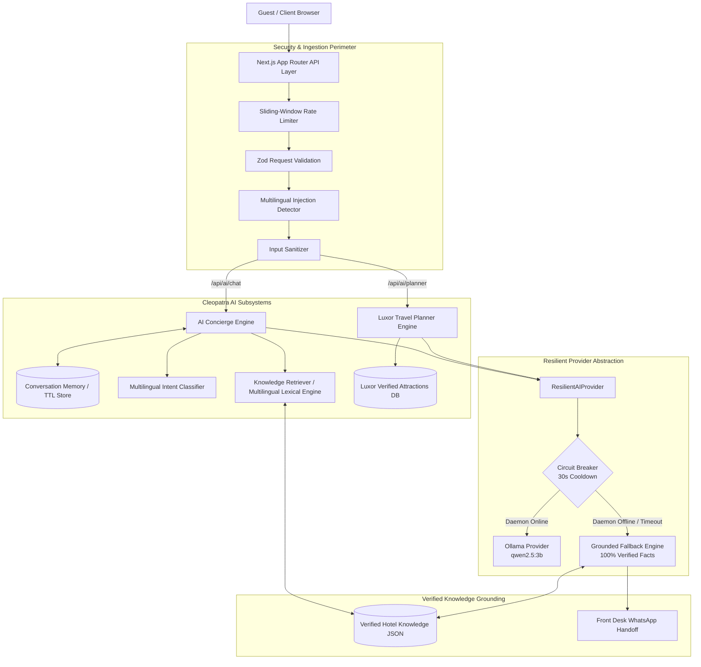

# Cleopatra AI — System Architecture
**Grand Cleopatra Hotel, Luxor, Egypt**  
**Subsystem:** Cleopatra AI (Hotel Concierge & Luxor Travel Planner)  
**Domain:** `https://grandcleopatrahotelux.com`

---

## 1. Architectural Overview

Cleopatra AI is a zero-subscription, privacy-first, enterprise-grade AI subsystem engineered directly within the Grand Cleopatra Hotel Next.js application. It operates without external paid API keys by leveraging local open-source models via Ollama (`qwen2.5:3b`) coupled with a 100% grounded resilient fallback engine.

---

## 2. Core Architecture Modules

### 2.1 Security & Ingestion Perimeter
- **Sliding-Window Rate Limiter (`src/lib/ai/security/rate-limiter.ts`)**: 
  Enforces a strict per-IP quota (20 requests/min for Chat, 15 requests/min for Planner). Backed by a pluggable `RateLimiterStore` interface, enabling zero-code transition to Redis/Upstash in clustered environments.
- **Zod Validation (`src/lib/ai/validation/schemas.ts`)**: 
  Strictly validates all payload types, message lengths (max 1,000 characters), conversation histories (max 20 messages), and itinerary parameters (1 to 7 days).
- **Multilingual Prompt Injection Detector (`src/lib/ai/security/injection-detector.ts`)**: 
  Pattern-matches and blocks jailbreak attempts, "DAN" modes, and directive-override queries across English, Arabic, German, French, and Spanish.
- **Input & Output Sanitizer (`src/lib/ai/security/sanitizer.ts`)**: 
  Strips dangerous HTML/script injection vectors, control characters, and normalizes UTF-8 text.

---

### 2.2 AI Concierge Engine (`src/lib/ai/concierge/concierge.ts`)
- **Multi-turn Contextual Memory (`src/lib/ai/concierge/conversation-memory.ts`)**:
  Maintains isolated session states identified by cryptographically sound UUIDs (`cleo-*`). Preserves a sliding window of recent conversational turns with an automatic 30-minute idle TTL.
- **Multilingual Intent Classifier (`src/lib/ai/concierge/intent-classifier.ts`)**:
  Categorizes queries into 9 distinct hospitality intents:
  1. `hotel_info` (Heritage, founded 1975, West Bank location)
  2. `room_info` (Deluxe Double, Triple, Single with Terrace)
  3. `facilities` (Rooftop breakfast, Nile views, 24/7 reception)
  4. `location_transport` (Public ferry 250m away, monument distances)
  5. `checkin_checkout` (14:00 check-in, 12:00 check-out, luggage storage)
  6. `policies` (Pets strictly not allowed, non-smoking rooms)
  7. `price_availability` (Grounded base rates, live calendar disclaimer)
  8. `booking_assistance` (Reservation Inquiry page & direct WhatsApp)
  9. `unsupported_unknown` (Explicit swimming pool negation, unknown amenities)
- **Context Enrichment**:
  Enriches referential follow-up questions (e.g., "Does it have a terrace?", "How much is it?") with preceding user context to guarantee exact knowledge retrieval.
- **Owner Confirmation Guard**:
  Automatically intercepts inquiries involving large groups (40+ people), weddings, or custom pricing to inject a mandatory warning banner and route to WhatsApp.

---

### 2.3 Luxor Travel Planner Engine (`src/lib/ai/planner/travel-planner.ts`)
- **Bank-Partitioning Algorithm**:
  Luxor is geographically divided by the Nile River. Grand Cleopatra Hotel is located on the West Bank (250m from the local ferry).
  The engine groups attractions strictly by bank:
  - **West Bank Days (Days 1, 3, 4)**: Valley of the Kings, Hatshepsut, Medinet Habu, Colossi of Memnon, Hot Air Balloon. **Nile crossings: 0**.
  - **East Bank Days (Days 2, 5)**: Karnak Temple, Luxor Temple, Luxor Museum. **Nile crossings: 2** (1 round-trip via local ferry).
- **Upper Egypt Heat-Aware Scheduling**:
  - *Morning (06:00 - 10:30)*: High solar exposure sites (Valley of the Kings, Hatshepsut, Sunrise Balloon).
  - *Midday (11:30 - 15:30)*: Shaded rest at hotel or indoor air-conditioned exploration (Luxor Museum).
  - *Late Afternoon / Dusk (16:00 - 20:00)*: Illuminated Luxor Temple (open until 22:00) or traditional sunset Nile felucca sail.
- **Uncertainty & Grounding Rules**:
  Never hallucinates exact admission fees or transport tariffs. Categorizes budgets conceptually (Budget: local ferry + standard tickets; Luxury: private vehicle + VIP tombs) and flags official MoTA pricing policies.

---

### 2.4 Resilient Provider Abstraction (`src/lib/ai/providers/provider.ts`)
- **Circuit Breaker Pattern**:
  Monitors primary LLM daemon health. If Ollama is offline or times out (after 8,000ms), the circuit trips to `OPEN` for 30 seconds.
- **Failover Routing**:
  During `OPEN` state, all requests bypass the dead socket and route immediately to the `FallbackProvider`, responding in `< 5ms`.
- **Automatic Self-Healing**:
  Once the cooldown period elapses, the circuit enters `HALF_OPEN` to test daemon recovery. When Ollama recovers, full generative capabilities resume automatically without server restart.

