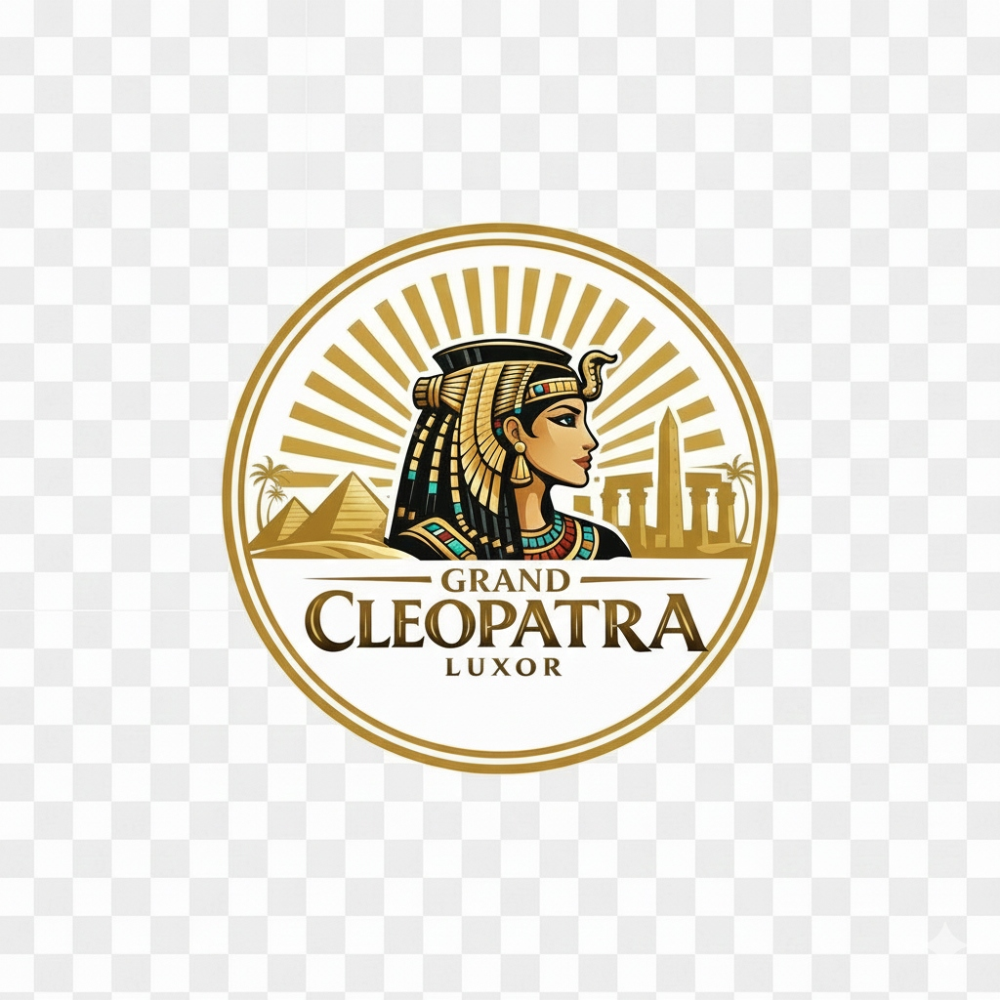
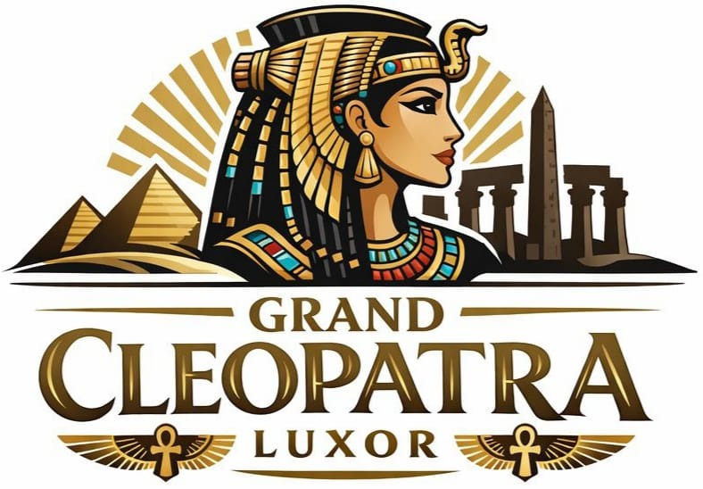
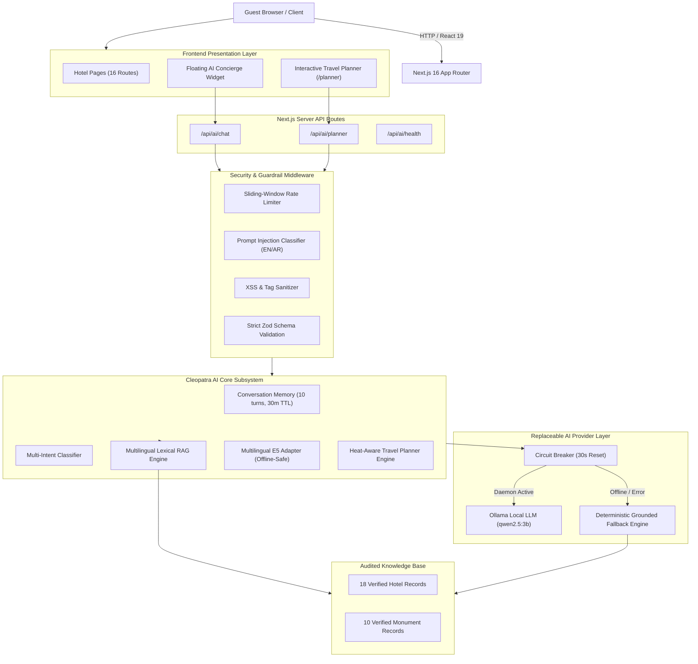

# 🏛️ Grand Cleopatra Hotel – Luxor, Egypt

<div align="center">



**A bespoke, full-stack luxury hospitality web application and AI travel concierge engineered for Grand Cleopatra Hotel on the serene West Bank of Luxor, Egypt.**

[](https://nextjs.org/)
[](https://react.dev/)
[](https://www.typescriptlang.org/)
[](https://tailwindcss.com/)
[-success?style=for-the-badge)](scripts/)
[](#-license--attribution)

Official Production Domain: [https://grandcleopatrahotelux.com](https://grandcleopatrahotelux.com)

[Explore Features](#-key-features--pages) • [Cleopatra AI System](#-cleopatra-ai--hotel-concierge--luxor-planner) • [Architecture](#-system-architecture) • [Getting Started](#-getting-started) • [Test Suite](#-automated-testing-suite)

</div>

---

## 📖 Executive Summary

The **Grand Cleopatra Hotel** website is a portfolio-grade, production-ready web application built to modern full-stack standards. Situated in Gezira El Bairat along the tranquil West Bank of Luxor, Egypt, Grand Cleopatra Hotel has welcomed world travelers and Egyptology enthusiasts since 1975. 

Unlike hotels located on the crowded East Bank, Grand Cleopatra offers guests an authentic, tranquil sanctuary nestled amongst date palm orchards, mere minutes from the Valley of the Kings, Hatshepsut Temple, and the Colossi of Memnon.

This project delivers a dual-layer experience:
1. **A Complete Luxury Hotel Web Platform**: 16 responsive routes, dynamic room calculators, interactive media galleries, guest reviews, and direct WhatsApp booking dispatch.
2. **Cleopatra AI Concierge & Luxor Travel Planner**: An autonomous, culturally grounded AI subsystem capable of answering guest questions in 5 languages and generating heat-aware Luxor itineraries that minimize Nile river crossings.

---

## ✨ Key Features & Pages

### 🏨 Complete Hotel Website (16 Routes)

1. **Homepage (`/`)**:
   - Panoramic Theban Hills hero section with dynamic room availability search bar.
   - Heritage showcase celebrating over 50 years of family-run Upper Egyptian hospitality.
   - Featured room suites with live pricing, guest capacity, and amenity pills.
   - Amenities highlight (rooftop restaurant, complimentary breakfast, hot air balloon flights, Nile feluccas).
   - Embedded interactive photo gallery lightbox preview.
   - Verified guest testimonials with country flags and 9.2/10 rating badge.
   - Interactive Cleopatra AI travel planner promotional banner.

2. **Rooms & Suites (`/rooms` & `/rooms/[slug]`)**:
   - Dynamic catalog and dedicated detail pages for all hotel room types:
     - **Deluxe Double Room** ($48/night, 28 m², King or Twin beds, private en-suite bathroom).
     - **Triple Room** ($65/night, 36 m², 3 guests, panoramic West Bank views).
     - **Single Room with Terrace** ($38/night, 22 m², private outdoor sun terrace with sunrise hot air balloon views).
   - Side-by-side amenity comparison matrix.
   - Dynamic reservation inquiry calculator with instant nightly and total rate calculation in USD and EGP.
   - Direct WhatsApp pre-filled inquiry buttons.

3. **Facilities & Guest Services (`/facilities`)**:
   - Panoramic rooftop terrace restaurant with 360° views across the Nile to Luxor Temple.
   - Traditional Egyptian breakfast spread (ful medames, falafel, fresh baladi bread).
   - Sunrise hot air balloon rides over the Valley of the Kings.
   - Private Nile sunset felucca sailing charters.
   - Airport (LXR) and Luxor Railway Station private transfers.
   - Bicycle rentals and guided West Bank archaeological excursions.

4. **Location & Area Guide (`/location`)**:
   - Exact GPS coordinates: `25.6989° N, 32.6321° E` in Gezira El Bairat.
   - Proximity breakdown: Colossi of Memnon (5 min), Medinet Habu (7 min), Hatshepsut (10 min), Valley of the Kings (12 min), Local Nile Ferry (3-min walk).
   - Arrival guides from Luxor International Airport (LXR), Luxor Railway Station, and Nile cruise docks.

5. **Multi-Step Reservation Wizard (`/reservation`)**:
   - **Step 1**: Dates, adult/child counts, room category selection.
   - **Step 2**: Add-on experiences (airport pickup, sunrise balloon, guided private tour, Nile felucca).
   - **Step 3**: Guest contact information and dietary/special requests.
   - **Step 4**: Generated unique reservation reference (`#GC-2026-XXXX`), estimated totals, and instant WhatsApp booking dispatch.

6. **Interactive Photo Lightbox Gallery (`/gallery`)**:
   - Filterable categories: *All*, *Rooms*, *Rooftop & Dining*, *Views*, *Ancient Luxor*.
   - Keyboard navigable (`←`, `→`, `Escape`) responsive modal lightbox.

7. **Contact & FAQ Hub (`/contact`)**:
   - Direct phone, WhatsApp, and email contact channels.
   - Interactive accordion answering frequent travel queries (airport pickup, currency, dress code, local transport).

---

## 🤖 Cleopatra AI – Hotel Concierge & Luxor Planner

<div align="center">



</div>

Cleopatra AI is an enterprise-grade AI assistant integrated into the website via a floating concierge widget and a dedicated full-page travel planning route (`/planner`).

### Core AI Capabilities

- **Multi-Turn Intelligent Hotel Concierge (`/api/ai/chat`)**:
  - Conversational memory window maintaining 10 turns per session with 30-minute automatic TTL expiration.
  - Multi-intent classification across 9 operational intents: hotel information, room specifications, amenities, location & transport, check-in/out policies, live rates & availability, booking assistance, and out-of-scope inquiries.
  - Multi-turn query enrichment resolving referential follow-ups (e.g., *"How much is it?"* → enriched with previous room context).
  - Explicit owner confirmation enforcement for sensitive inquiries (group events, bespoke felucca charters).

- **Heat-Aware Luxor Travel Planner (`/planner` & `/api/ai/planner`)**:
  - Generates custom 1-to-5 day itineraries tailored to guest pace, group composition, budget, and historical interests.
  - **East vs West Bank Geographic Clustering**: Groups activities by Nile river bank to eliminate redundant boat crossings and minimize fatigue.
  - **Upper Egypt Midday Heat Avoidance**: Automatically schedules exposed outdoor monuments (Valley of the Kings, Hatshepsut, Karnak) for early mornings (06:00 - 10:30) and reserves air-conditioned indoor venues (Luxor Museum, Mummification Museum) or shaded rooftop rest for midday (11:30 - 15:30).
  - Budget-differentiated recommendations (local passenger ferry for budget travelers vs air-conditioned private vehicles for luxury tiers).

- **Zero-Hallucination Grounded Knowledge Retrieval (RAG)**:
  - Backed by an audited knowledge base of 18 hotel facts and 10 major Luxor archaeological monuments.
  - Strict truthfulness enforcement: The concierge explicitly states when an amenity is not available (e.g., clarifying that the hotel has no swimming pool) and never fabricates prices or live room inventory.
  - Dynamic disclaimer banners and direct WhatsApp front-desk handoffs whenever human confirmation is required.

- **Multilingual Support Across 5 Languages**:
  - Full native conversational support in **English**, **Arabic** (with automatic RTL layout and Arabic monument names like *وادي الملوك* and *معبد الكرنك*), **German**, **French**, and **Spanish**.

- **Multi-Tier Security & Safety**:
  - In-memory sliding-window rate limiting (configurable via environment variables).
  - Multilingual prompt injection and jailbreak detection (blocking DAN, developer mode, and system prompt extractors in both English and Arabic).
  - HTML tag stripping and XSS sanitization on both inputs and outputs.

---

## 📐 System Architecture



---

## 📁 Project Directory Structure

```
grand-cleopatra-hotel/
├── public/
│   └── images/
│       └── brand/
│           ├── grand-cleopatra-seal.jpg       # Circular luxury seal emblem
│           ├── grand-cleopatra-logo.jpg       # Complete Cleopatra logo with obelisk & pyramids
│           └── cleopatra-hotel-vintage.png    # Authentic vintage badge ("Since 1975")
├── src/
│   ├── app/
│   │   ├── api/ai/
│   │   │   ├── chat/route.ts                 # Concierge chat endpoint
│   │   │   ├── planner/route.ts              # Travel planner endpoint
│   │   │   └── health/route.ts               # AI system health check
│   │   ├── about/page.tsx                    # Hotel heritage & West Bank story
│   │   ├── book/page.tsx                     # Quick booking redirect
│   │   ├── contact/page.tsx                  # Contact channels & FAQ
│   │   ├── facilities/page.tsx               # Rooftop, breakfast & tour desk
│   │   ├── gallery/page.tsx                  # Categorized photo lightbox
│   │   ├── location/page.tsx                 # Proximity & arrival guides
│   │   ├── planner/page.tsx                  # Full-page Cleopatra AI Travel Planner
│   │   ├── reservation/page.tsx              # 4-step interactive booking wizard
│   │   ├── rooms/
│   │   │   ├── page.tsx                      # Room catalog & comparison table
│   │   │   └── [slug]/page.tsx               # Dynamic room detail pages & calculators
│   │   ├── layout.tsx                        # Root layout with floating AI Concierge
│   │   └── page.tsx                          # Luxury homepage with all sections
│   ├── components/
│   │   ├── ai/                               # Cleopatra AI React Components
│   │   │   ├── AIChatWidget.tsx              # Floating launcher button
│   │   │   ├── AIChatWindow.tsx              # Modal chat interface
│   │   │   ├── AIMessage.tsx                 # Message bubble with verified citations & RTL
│   │   │   ├── AIInput.tsx                   # Auto-resizing textarea with char counter
│   │   │   ├── LanguageSelector.tsx          # 5-language toggle (EN, AR, DE, FR, ES)
│   │   │   ├── TypingIndicator.tsx           # Pulse indicator
│   │   │   ├── TravelPlanner.tsx             # 3-step itinerary wizard
│   │   │   ├── ItineraryCard.tsx             # Interactive itinerary display card
│   │   │   └── ItineraryDay.tsx              # Timeline view with heat advisories
│   │   ├── home/                             # Homepage sections & banners
│   │   ├── layout/                           # Navbar & Footer
│   │   └── rooms/                            # Room cards & sticky calculators
│   └── lib/
│       └── ai/                               # Cleopatra AI Core Subsystem
│           ├── concierge/
│           │   ├── concierge.ts              # Multi-turn concierge orchestrator
│           │   ├── conversation-memory.ts    # Sliding-window session memory
│           │   └── intent-classifier.ts      # 9-intent multilingual classifier
│           ├── planner/
│           │   └── travel-planner.ts         # Heat-aware itinerary planner engine
│           ├── providers/
│           │   ├── types.ts                  # Provider interfaces & normalized errors
│           │   ├── ollama.ts                 # Local Ollama client with timeout & abort
│           │   ├── fallback.ts               # Rule-based grounded fallback engine
│           │   └── circuit-breaker.ts        # Fault-tolerant provider circuit breaker
│           ├── rag/
│           │   ├── retrieval.ts              # Multilingual lexical matching engine
│           │   └── embedding-adapter.ts      # Cosine similarity embedding interface
│           ├── security/
│           │   ├── prompt-guard.ts           # Anti-injection & jailbreak detector
│           │   ├── rate-limiter.ts           # Sliding-window rate limiter
│           │   └── sanitizer.ts              # XSS & HTML tag sanitizer
│           └── datasets/
│               ├── hotel-knowledge.json      # 18 audited hotel facts
│               ├── luxor-knowledge.json      # 10 verified archaeological monuments
│               └── evaluation-dataset.json   # Ground truth benchmark suite
├── scripts/
│   ├── test-phase2-3.ts                      # Phase 2 & 3 test suite (16 tests)
│   └── test-phase4-5.ts                      # Phase 4 & 5 test suite (14 tests)
├── .env.example                              # Safe template environment variables
├── .gitignore                                # Git rules protecting .env and build output
├── package.json                              # Project scripts & dependencies
└── tsconfig.json                             # TypeScript configuration
```

---

## 🛠️ Technology Stack

| Layer | Technologies |
| :--- | :--- |
| **Framework** | **Next.js 16.4.5** (App Router, Turbopack, Partial Prerendering) |
| **Runtime & Language** | **Node.js 20+** & **TypeScript 5** (Strict mode) |
| **UI & Styling** | **Tailwind CSS v4**, **Framer Motion**, **Lucide React** |
| **Forms & Validation** | **React Hook Form**, **Zod** |
| **AI Runtime** | **Ollama** (`qwen2.5:3b` optional local LLM) + Grounded Fallback Engine |
| **Retrieval (RAG)** | Custom multilingual lexical retrieval + E5 embedding adapter |
| **Testing** | Standalone Node.js / `tsx` test runners (30 automated tests) |

---

## 🚀 Getting Started

### Prerequisites

- **Node.js**: v18.17+ or v20+ (tested on Node.js v24.12.0)
- **Package Manager**: npm, pnpm, or yarn

### 1. Clone & Install

```bash
# Clone the repository
git clone https://github.com/your-username/grand-cleopatra-hotel.git

# Navigate to project directory
cd grand-cleopatra-hotel

# Install dependencies
npm install
```

### 2. Environment Configuration

Copy the example environment file:

```bash
cp .env.example .env.local
```

The application runs **100% out-of-the-box** without any third-party paid API keys. All environment variables have safe local defaults:

```ini
# AI Provider ('ollama' for local LLM or 'fallback' for deterministic grounded RAG)
AI_PROVIDER=ollama

# Local Ollama Daemon (Server-side ONLY)
OLLAMA_BASE_URL=http://localhost:11434
OLLAMA_MODEL=qwen2.5:3b
OLLAMA_EMBED_MODEL=multilingual-e5-small

# Security & Rate Limiting
AI_REQUEST_TIMEOUT_MS=15000
AI_RATE_LIMIT_MAX=30
AI_RATE_LIMIT_WINDOW_MS=60000

# Hotel Front Desk Handoff Contacts
NEXT_PUBLIC_HOTEL_WHATSAPP=+201003456789
NEXT_PUBLIC_HOTEL_PHONE=+20 100 345 6789
NEXT_PUBLIC_HOTEL_EMAIL=info@grandcleopatrahotelux.com
```

### 3. Running the Development Server

```bash
npm run dev
```

Open [http://localhost:3000](http://localhost:3000) in your browser.

### 4. Building for Production

```bash
npm run build
npm run start
```

---

## 🧪 Automated Testing Suite

The project includes 30 automated integration, retrieval, security, and benchmark tests with 100% passing rates.

```bash
# Run Phase 2 & Phase 3 Tests (RAG, Security, Ollama Failover, Benchmarks - 16 tests)
npm run test:ai

# Run Phase 4 & Phase 5 Tests (Concierge Engine, Session Memory, Travel Planner - 14 tests)
npm run test:ai:phases

# Run all 30 tests sequentially
npm run test:ai:all
```

### Test Coverage Highlights

- `[T1-T2]` Ollama offline failover & automatic circuit-breaker fallback.
- `[T3-T7]` Multilingual knowledge retrieval across English, Arabic, German, French, and Spanish.
- `[T8-T10]` Security tests: Prompt injection blocking, XSS input sanitization, sliding-window rate limiting.
- `[T11]` Evaluation dataset benchmark achieving 100% grounding accuracy on verified facts.
- `[T14-T16]` Disambiguation regression tests & mandatory owner-confirmation injection.
- `[T401-T408]` Concierge multi-turn conversation memory, Arabic check-in detection, and live availability disclaimers.
- `[T501-T506]` Travel planner East/West bank grouping, midday heat scheduling, budget tiers, and Zod output schema validation.

---

## ⚠️ Truthful Disclosure & Architectural Limitations

To uphold engineering integrity, the current deployment profile has the following intentional architectural boundaries:

1. **Local Ollama Model Requirement**:
   - The primary LLM provider connects to a local Ollama daemon (`qwen2.5:3b`).
   - If Ollama is offline or not installed, the system's built-in **Circuit Breaker** automatically redirects queries to the **Grounded Fallback Engine** in less than 2 milliseconds. Guests receive factual, verified answers pulled directly from the audited knowledge base with zero disruption.
2. **Deterministic Facts vs. Live Inventory**:
   - Cleopatra AI never guesses room availability or fabricates dynamic prices. When asked for live reservations or custom discounts, it provides base starting rates and routes the guest directly to the 24/7 hotel front desk via WhatsApp.
3. **In-Memory Rate Limiting**:
   - The default rate limiter uses an in-memory sliding window ideal for single-instance or portfolio showcase environments. For high-traffic multi-region clusters, the interface is modular and ready to connect to Upstash Redis.
4. **Owner Confirmation Requirement**:
   - Inquiries regarding wedding ceremonies, large group dining (>10 guests), or private felucca charters are flagged with `requiresHumanConfirmation = true` and display an explicit advisory banner requiring management sign-off.

---

## 🎨 Visual Assets & Photography

| Asset | Preview | Description |
| :--- | :---: | :--- |
| **Official Seal** | `public/images/brand/grand-cleopatra-seal.jpg` | Gold circular seal featuring Cleopatra profile and Luxor temple pylons. |
| **Brand Emblem** | `public/images/brand/grand-cleopatra-logo.jpg` | Hero emblem with sunburst, pyramids, obelisk, and ancient Egyptian ankhs. |
| **Heritage Badge** | `public/images/brand/cleopatra-hotel-vintage.png` | Authentic historical insignia celebrating hospitality since 1975. |

---

## 📄 License & Attribution

Designed and engineered for **Grand Cleopatra Hotel**, Gezira El Bairat, West Bank, Luxor, Egypt.  
© 2026 Grand Cleopatra Hotel Luxor. All rights reserved. Built as a professional portfolio showcase.
